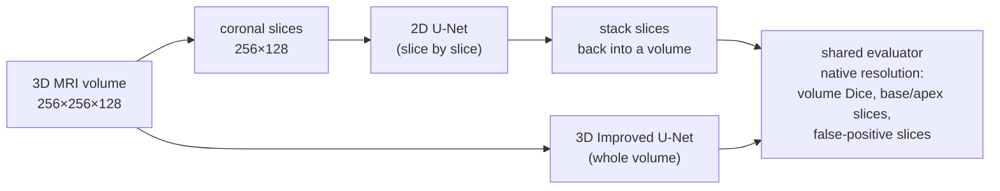
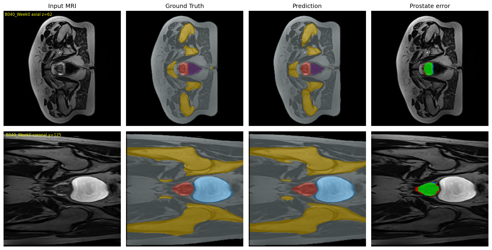
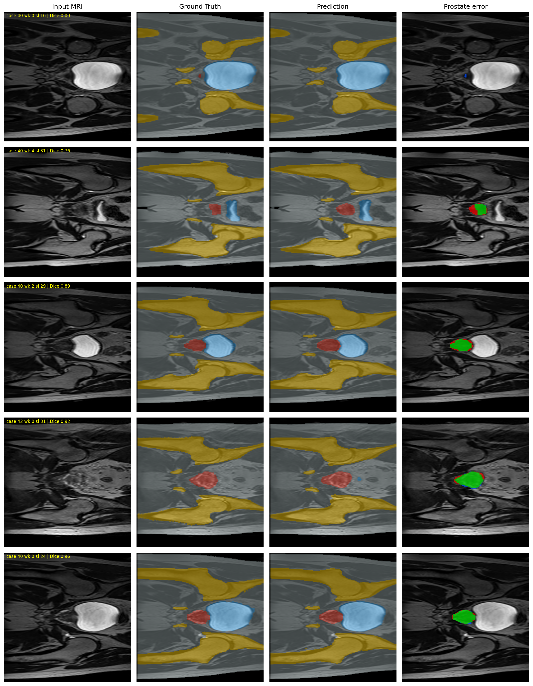
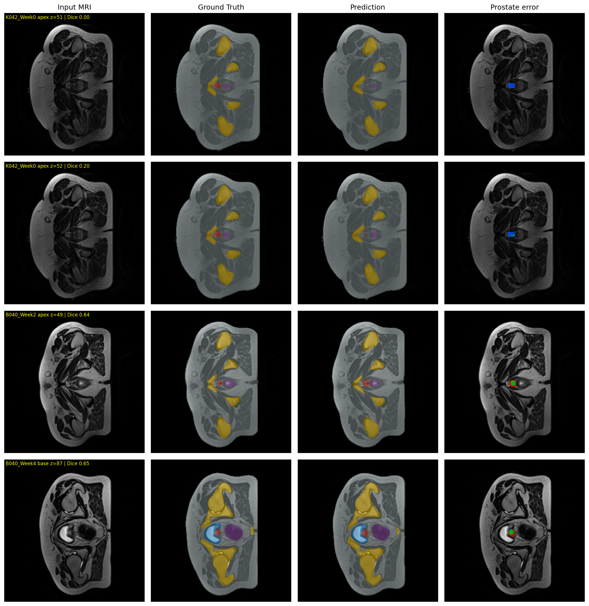
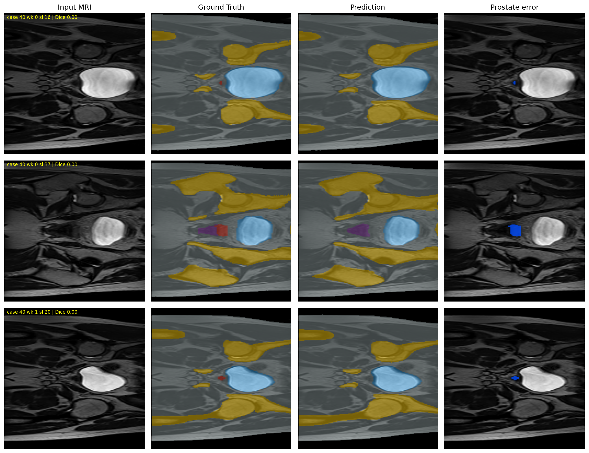

# Prostate Segmentation on HipMRI: 2D U-Net vs 3D Improved U-Net

**Student:** s4983493 · **Project:** 2.2 Segmentation — Prostate Radiotherapy Planning (HipMRI) · **Difficulty:** Hard (3D Improved U-Net) · **Baseline:** 2D U-Net

## 1. Problem and Algorithm

External-beam radiotherapy for prostate cancer needs an accurate contour of the prostate on MRI, while sparing the bladder and rectum next to it. Contouring by hand is slow, so the goal is an assistant that drafts the contour for a planner to review. The difficulty is that the prostate is tiny (about 0.1% of the voxels in a pelvic volume) and its ends, the **base** (next to the bladder) and the **apex** (the inferior tip), have small cross-sections with low contrast against the neighbouring organs. This project asks the course's open question: *does true 3D volumetric context remove the boundary and slice-transition errors of a 2D slice-wise model, or does it only smooth the easy central slices at several times the cost?*

**How it works.** Both models are fully convolutional encoder–decoders that label every pixel (2D) or voxel (3D) as one of 6 classes: background, body, bone, bladder, rectum, prostate. The **baseline** is a standard 4-level 2D U-Net [1] that segments one coronal slice at a time, so it cannot see neighbouring slices. The **proposed model** is the 3D Improved U-Net of Isensee et al. [2], applied to whole volumes. Its encoder uses *context modules* (pre-activation residual blocks with dropout) joined by stride-2 convolutions. Its decoder uses *upsampling* and *localisation modules*, and segmentation outputs from three decoder levels are upsampled and summed into the final output (deep supervision). Instance normalisation and leaky ReLU are used throughout, as in the paper. Both models are trained with the same loss, 0.5 × soft Dice + 0.5 × cross-entropy, which copes with the severe class imbalance. Both are then scored on **the same 3D test volumes** with one shared evaluator.




*Figure 1. 3D Improved U-Net on test volume B040 Week 0. Top: axial slice. Bottom: coronal slice (the same plane as the 2D dataset). Error column: green = correct prostate, red = false positive, blue = false negative.*

## 2. Feasibility Review (Midpoint Check-off)

*This is the one-page review presented at the check-off, unchanged. Section 7 evaluates its acceptance criteria against the final results.*

**Project:** HipMRI prostate segmentation — does 3D context fix the edge-of-gland failures of a 2D baseline?
**Student:** s4983493 · **Band:** Hard (3D Improved U-Net) · **Baseline:** 2D U-Net

### 2.1 User need and acceptance criteria
The user is a radiotherapy planner who corrects automatic prostate contours. The critical errors are **missed prostate at the base/apex** (under-contouring → recurrence risk) and **leakage into the rectum or bladder** (over-contouring → toxicity), so a high global Dice alone does not count as success. Both models are scored on the same test patients, with 2D predictions re-assembled into volumes:

1. Volume-level prostate Dice of the 3D model ≥ 0.70 and not below the 2D baseline.
2. On the first and last two prostate slices of each volume (base/apex), the 3D model misses fewer slices than the 2D baseline, by more than the seed-to-seed variation.
3. No increase in false-positive prostate slices (2D baseline: 0).
4. Inference fits on a 16 GB GPU; parameters, peak VRAM and latency per volume are reported on the same GPU.
5. Train/validation/test are split by patient, identical for 2D and 3D, with all weekly scans of a patient in one split.

### 2.2 Models
- **Baseline: 2D U-Net** (Ronneberger et al., 2015). It works slice by slice, with no context from neighbouring slices.
- **Proposed: 3D Improved U-Net** (Isensee et al., 2017). It uses residual context modules, localisation modules, deep supervision and instance norm, and gives every voxel inter-slice context.
- Both use the same Dice + cross-entropy loss, because the prostate is a small, imbalanced class (about 0.1–0.5% of voxels).

### 2.3 Evidence so far
- **Data audit.** There are 6 labels, and the prostate is label 5 (checked visually in 2D and 3D). Splits share no patients. The 2D slices are coronal slices of the same patients' 3D volumes (checked by image correlation), so both models can be scored on identical test volumes.
- **2D baseline, trained** (20 epochs). Test prostate Dice is **0.873** globally but only **0.740** per slice. A second seed gave 0.866 / 0.718, so the per-slice score varies by about 0.02. The worst slices are complete misses (Dice 0) of tiny cross-sections at the edge of the gland, with zero false positives. The failure mode is **under-contouring**, which is the case 3D context should help.
- **Cost.** 31.0 M parameters, 1.9 GB peak VRAM, 9.3 min training and 3.6 ms per slice on an A100.
- **3D pipeline.** It runs end to end and is being corrected for the issues found in the 2D audit.

### 2.4 Risks and fallback
- **GPU memory.** Resample in-plane only, keeping the full superior–inferior resolution; use batch size 2, bf16 and an A100.
- **Few patients (38).** Rely on the patient-level split, use only anatomically plausible augmentation, and report results over several seeds.
- **Unfair comparison.** Use one shared volume-level evaluator at native resolution for both models.
- **Fallback.** Submit a plain 3D U-Net (Normal band) with the same comparison.

## 3. Repository Structure

| File | Content |
|---|---|
| `modules.py` | `UNet2D`, `ImprovedUNet3D`, the shared Dice + CE loss and Dice metrics (pure PyTorch, no NumPy) |
| `dataset.py` | 2D slice dataset and 3D volume dataset, patient-level splits, preprocessing and augmentation |
| `train.py` | Training, validation, testing and checkpointing for either model (`--model 2d` / `--model 3d`); plots loss and Dice curves |
| `predict.py` | Loads a trained model, evaluates it on the test split, saves figures (and per-volume predictions for 3D) |
| `compare_2d_3d.py` | Runs the 2D model on the coronal slices of the 3D test volumes and scores both models with the same evaluator |
| `audit_2d.py`, `audit_3d.py`, `verify_2d_3d_alignment.py` | Data audits: label values and shares, split overlap, 2D↔3D patient and orientation correspondence |

## 4. Dependencies and Reproducibility

> **TODO (fill in before submission):** exact versions from the training environment, e.g. run
> `!python -c "import sys, torch, numpy, nibabel, matplotlib, scipy; print(sys.version, torch.__version__, torch.version.cuda, numpy.__version__, nibabel.__version__, matplotlib.__version__, scipy.__version__)"` in Colab.

| Package | Version |
|---|---|
| Python | TODO |
| PyTorch (CUDA) | TODO |
| NumPy | TODO |
| nibabel | TODO |
| matplotlib | TODO |
| SciPy (only for the connected-component post-processing) | TODO |

**Hardware.** Google Colab, NVIDIA A100-SXM4-80GB (one 2D run on a Tesla T4). All runs use mixed precision: fp16 for 2D, bf16 for 3D.

**Reproducibility.**
- Every run except the first 2D run (T4) uses a fixed `--seed`. cuDNN is not forced into deterministic mode, so re-runs can still differ slightly. This is why results are reported over several seeds.
- The data split is not random. It is the split provided with the 2D dataset, and the 3D split mirrors it (Section 5.3), so it is identical on every machine.
- `train.py` writes the GPU, seed, hyperparameters, best epoch, peak VRAM and training time into `test_results.txt` next to every checkpoint.

**Commands** (paths are examples; data from `/home/groups/comp3710/HipMRI_Study_open`):

```bash
# data audits
python audit_2d.py  <keras_slices_data>
python audit_3d.py  <semantic_MRs> <semantic_labels_only> <keras_slices_data>
python verify_2d_3d_alignment.py <semantic_MRs> <semantic_labels_only> <keras_slices_data>

# 2D baseline (defaults: 20 epochs, batch 16, lr 1e-3, 64 base filters)
python train.py --model 2d --data_root <keras_slices_data> --save_dir checkpoints_2d_seed1 --amp --seed 1
python predict.py --model 2d --data_root <keras_slices_data> --checkpoint checkpoints_2d_seed1/best_model.pth

# 3D Improved U-Net (defaults: native 128×256×256 grid, batch 2, lr 5e-4, ≤150 epochs, early stop 25)
python train.py --model 3d --image_dir <semantic_MRs> --mask_dir <semantic_labels_only> \
    --cache_dir /content/cache3d --save_dir checkpoints_3d_seed1 --amp --seed 1
python predict.py --model 3d --image_dir <semantic_MRs> --mask_dir <semantic_labels_only> \
    --checkpoint checkpoints_3d_seed1/best_model.pth --save_dir predictions_3d_seed1

# head-to-head comparison on the same 3D test volumes
python compare_2d_3d.py --image_dir <semantic_MRs> --mask_dir <semantic_labels_only> \
    --ckpt2d checkpoints_2d_seed1/best_model.pth --preds3d predictions_3d_seed1/preds \
    --save_dir comparison_seed1

# resolution ablation (3D on a coarser grid)
python train.py --model 3d ... --target_shape 128 128 128 --save_dir checkpoints_3d_lowres_seed1 --amp --seed 1
```

Datasets and model weights are not committed (see `.gitignore`).

## 5. Data, Preprocessing and Splits

### 5.1 Data audit
Every mask was audited before training (`audit_2d.py`, `audit_3d.py`):

| | 2D slices (`keras_slices_data`) | 3D volumes (`semantic_MRs`) |
|---|---|---|
| Size | 11 460 / 660 / 540 slices (train / val / test) | 211 volumes, 38 patients |
| Shape | 256×128 (one volume's slices 256×144) | 256×256×128 (one volume ×144) |
| Labels | 0–5 in all splits | 0–5 in every volume |
| Prostate (label 5) | 0.3–0.5% of pixels, in ~35% of slices | 0.1% of voxels |

The prostate label was identified **visually** (Figure 2): label 5 is the round structure between the bladder (label 3) and the rectum (label 4). It was not identified from pixel shares (see Section 9).

**The 2D slices are coronal slices of the 3D volumes.** Each 2D slice is a left–right × superior–inferior plane, the 256×144 slices come from the one volume with 144 axial slices, and the 2D slices of case 40 match the 3D volume of patient B040 at a constant offset of 97–98 coronal indices (`verify_2d_3d_alignment.py`; the control patient does not match). Every volume contributes **exactly 60** coronal slices to the 2D dataset (11 460 / 191, 660 / 11 and 540 / 9 volumes), i.e. a ~10 cm anterior–posterior slab around the prostate. This turns out to matter (Section 6.4). It also means that "base/apex" must be measured on **axial** slices of the volumes, not on the 2D slices.


*Figure 2. Left: axial slice of 3D patient B040 with label 4 (cyan, rectum) and label 5 (magenta, prostate). Middle: the 3D coronal slice that best matches 2D slice 24 of case 40 (right).*

### 5.2 Preprocessing
- **2D:** slices are resized to 256×128 (only the 256×144 slices change) and z-scored per slice. Augmentation: random left–right flip only.
- **3D:** volumes are reordered to (D, H, W) = (superior–inferior, left–right, anterior–posterior) and z-scored per volume. The final model uses the **native grid** (128×256×256, ~1.7 mm in-plane, 1.56 mm between slices). The ablation uses 128×128×128 (in-plane halved). Augmentation: random left–right flip, mild intensity scale/shift (±10%) and Gaussian noise. Preprocessed volumes are cached to disk.
- **No anatomically impossible augmentation.** Vertical, superior–inferior and anterior–posterior flips and 180° rotations were removed. They would put the rectum in front of the bladder or swap base and apex, which are the structures under study.
- **Evaluation is always at native resolution.** For the ablation model, logits are upsampled back (trilinear) before the argmax.

### 5.3 Splits
Patient-level, identical for both models:

| Split | Patients | 2D slices | 3D volumes |
|---|---|---|---|
| Train | 31 (patients 4–35) | 11 460 | 191 |
| Validation | 4 (36–39) | 660 | 11 |
| Test | 3 (40–42: B040, W041, K042) | 540 | 9 |

The 2D dataset comes pre-split by patient, and no case ID is shared between splits (`audit_2d.py`). The 3D patient numbers are exactly the same set as the 2D case numbers, so the 3D split mirrors the 2D split. Two reasons for this: (1) every weekly scan of a patient stays in one split, so there is no leakage between scans of the same person, and (2) the 2D model has **never seen any 3D test patient**, so running it on the 3D test volumes is a fair, leakage-free comparison. A random 3D split would have put 2D training patients into the 3D test set.

**Limitation:** the test set has only 3 patients, and 7 of its 9 volumes come from B040. Results are therefore also reported per patient, and over several training seeds.

## 6. Results

### 6.1 Metric definitions
- **Global Dice:** intersections and unions summed over the whole test split, then one Dice. IoU follows exactly as IoU = Dice / (2 − Dice).
- **Per-slice / per-volume Dice:** Dice per slice (2D, slices containing prostate) or per volume (3D), then averaged.
- **Base / apex / inner:** in each test volume, the first and last *k* = 2 axial slices containing prostate in the ground truth are the gland's ends. The end nearer the bladder is the base, the other is the apex, and "inner" is everything in between. *Missed* = a GT slice where the model predicts no prostate at all.
- **False-positive (FP) slices:** axial slices with predicted prostate but none in the ground truth.

### 6.2 Training


*Figure 3. Loss and validation prostate Dice for the 2D U-Net (top) and the 3D Improved U-Net (bottom). The validation set has only 4 patients, so the validation Dice is noisy between epochs. This also makes the "best epoch" partly random: the best epochs were 18, 17 and 9 for the three 2D runs.*

### 6.3 Per-class results
Per-class DSC and IoU on the test patients. The 2D numbers are on the 2D test slices (the 60-slice slab), the 3D numbers on the full test volumes, so these two columns are **not** a head-to-head comparison. That comparison is in Section 6.4.

| Class | 2D U-Net DSC | 2D U-Net IoU | 3D Imp. U-Net DSC | 3D Imp. U-Net IoU |
|---|---|---|---|---|
| Background | 0.996 | 0.993 | 0.998 | 0.996 |
| Body | 0.985 | 0.971 | 0.986 | 0.973 |
| Bone | 0.938 | 0.883 | 0.919 | 0.850 |
| Bladder | 0.966 | 0.934 | 0.961 | 0.925 |
| Rectum | 0.870 | 0.770 | 0.836 | 0.718 |
| **Prostate** | **0.873** | **0.774** | **0.886** | **0.796** |

*2D: run on the T4, 2D test slices. 3D: native grid, seed 1, 9 test volumes. Both reach the course targets (prostate ≥ 0.75 for 2D, ≥ 0.70 for 3D).*

On the 2D test slices, the three 2D runs are nearly identical:

| 2D run | Global prostate Dice | Per-slice mean | FP slices (of 345 prostate-free) |
|---|---|---|---|
| T4 (no seed) | 0.873 | 0.740 | 0 |
| A100, seed 1 | 0.866 | 0.718 | 0 |
| A100, seed 2 | 0.873 | 0.744 | 2 |

The gap between global (0.87) and per-slice (0.72–0.74) Dice already shows the dilemma: slices with small prostate cross-sections are segmented much worse, and the pixel-weighted global score hides this.


*Figure 4. 2D U-Net on 2D test slices, from the worst to the best slice Dice.*

### 6.4 Head-to-head: the same 9 test volumes
All numbers are at native resolution. "Mean (range)" is over training seeds: three 2D runs, two 3D runs.

| Model | Volume Dice | Base Dice | Apex Dice (missed / 18) | Inner Dice | FP slices |
|---|---|---|---|---|---|
| 2D U-Net, raw | 0.638 (0.351–0.838) | 0.66 (0.50–0.79) | 0.56 (0.44–0.65) (0–2) | 0.81 (0.72–0.87) | 334–857 |
| 2D U-Net + largest component | 0.804 (0.673–0.871) | 0.721 (0.612–0.796) | 0.606 (0.472–0.674) (1–3) | 0.813 (0.682–0.881) | 30–105 |
| 2D U-Net + 60-slice slab | 0.868 (0.866–0.870) | 0.772 (0.756–0.796) | 0.669 (0.661–0.674) (1–3) | 0.878 (0.876–0.880) | 30–33 |
| 3D Imp. U-Net, 128×128×128 (ablation) | 0.836 | 0.682 | 0.672 (3) | 0.846 | 27 |
| **3D Imp. U-Net, native grid** | **0.888 (0.882–0.894)** | **0.799 (0.779–0.819)** | **0.669 (0.640–0.698) (1–4)** | **0.892 (0.890–0.893)** | **20–32** |

*"+ largest component": keep only the largest 3D connected prostate component. "+ 60-slice slab": keep 2D predictions only inside the coronal slab the 2D dataset covers (all GT prostate lies inside it, in every volume). Adding the largest-component step to the 3D model changes nothing (0.882 → 0.882), because it already predicts one connected gland.*

Per patient (raw volume Dice, 3D vs 2D), the 3D model is better for all three patients in both seed pairs, e.g. seed 1: B040 0.877 vs 0.836, K042 0.911 vs 0.845, W041 0.891 vs 0.852.

**The 2D model fails outside the slab it was trained on.** Run on all 256 coronal slices of a volume, every 2D model produces false positives far from the prostate, and how many depends on the training run: 334, 429 and 857 FP slices for three runs that were indistinguishable on the 2D test set (0.866–0.873). The worst of them (T4) drops to 0.351 volume Dice. Figure 5 shows where the false positives come from: almost all of them lie in coronal slices outside the training slab, which the 2D model never saw. The largest-component step does not reliably fix this. For the T4 run, some false-positive blobs were larger than the prostate, so it kept the wrong component and deleted real prostate (4 base slices missed).


*Figure 5. False-positive prostate voxels per coronal slice, summed over the 9 test volumes (log scale), for the 2D run on the T4 (blue) and the 3D model (orange). Grey: the 60-slice slab covered by the 2D dataset. Dashed: ground-truth prostate. The 2D false positives sit outside the slab. Inside it, both models only disagree with the ground truth at the gland's surface.*

### 6.5 Resource profile
All numbers on an A100 80 GB. Training times are from runs that had the GPU to themselves. Inference is fp32 with batch 1 (the 2D volume timing uses chunks of 32 slices).

| | 2D U-Net | 3D Imp. U-Net (native) | 3D Imp. U-Net (128³ ablation) |
|---|---|---|---|
| Parameters | 31.0 M | 9.5 M | 9.5 M |
| Training time | 9.3 min (20 epochs) | 37.9 min (early stop, best epoch 24) | 7.2 min |
| Peak training VRAM | 1.9 GB | 14.7 GB | 3.8 GB |
| Inference latency | 3.3 ms / slice; 283 ms / volume (256 slices); 112 ms / volume (60-slice slab) | 102 ms / volume | 30 ms / volume |
| Peak inference VRAM | not measured | 4.2 GB | 1.3 GB |

The 3D model costs **4.1× the training time and 7.8× the training memory** of the 2D baseline, inside the 5–10× range the brief anticipated. Training still fits on a 16 GB GPU. At inference time it is *not* more expensive: one 3D pass (102 ms) is faster than the 2D model over all coronal slices (283 ms) and about as fast as the 2D model on the slab alone (112 ms). The 2D timing includes copying the volume to the GPU, about a few ms, which the 3D timing does not.

### 6.6 Failure-case autopsies

*Figure 6. Base/apex axial slices with the largest 2D–3D differences (2D seed 1 vs 3D seed 1). Green TP, red FP, blue FN.*

1. **W041, apex (z = 59, 60). 2D misses, 3D finds it, but not reliably.** The prostate cross-section here is a few pixels across. The 2D model misses it entirely (slice Dice 0.00 / 0.13). The 3D seed-1 model gets 0.71 / 0.87, apparently helped by the gland continuing on the slices above. The 3D seed-2 model also scores 0.00 on this apex, though. *Trigger:* tiny cross-section with little contrast to the surrounding tissue. Neighbouring-slice context helps sometimes, but not robustly.
2. **K042, apex (z = 51, 52). Every model fails.** The apex lies directly against the rectum. Every 2D and 3D run scores a mean apex Dice between 0.00 and 0.23 on this volume. *Trigger:* the prostate–rectum interface at the apex. This is the case the brief warns about (rectal-wall leakage vs under-contouring). Both architectures fail, so this region is not suitable for automated drafting.
3. **B040 Week 1, apex (z = 51). 3D over-contours.** The 3D model draws a ring of false positives around the apex (Dice 0.65 vs 0.87 for 2D; Figure 6, bottom row). Its error is the opposite of the 2D model's: the 2D model tends to under-contour (blue), the 3D model sometimes over-contours (red). Clinically these differ: under-contouring risks recurrence, over-contouring irradiates healthy tissue.
4. **2D false positives outside the training slab (Figure 5).** Hundreds of slices with spurious prostate blobs at coronal positions 0–65 and 195–255, far from the pelvis centre. *Trigger:* distribution shift. The 2D model only ever saw the 60 slices around the prostate, and its behaviour elsewhere is unconstrained, differing wildly between training runs. Validation on the 2D test slices cannot detect this.
5. **2D slices at the anterior/posterior gland edge (Figure 8).** On the 2D test set, the worst slices (case 40, slices 16, 20, 37) are complete misses (Dice 0) of very small cross-sections, one of them at the prostate–rectum interface. The ground truth on slice 37 is a blocky rectangle, which suggests the reference contour is itself uncertain at the gland's edge. Part of the "error" at the extremities is therefore label noise, not only model failure.


*Figure 7. Worst base/apex slices of the 3D model (seed 1).*


*Figure 8. Worst 2D test slices of the 2D baseline.*

## 7. Discussion

**Does 3D context fix the boundary failures?** Only partly. In the fairest comparison (the 2D model limited to its training slab, which gives it the localisation the dataset curators did by hand), the 3D model is consistently better overall: volume Dice 0.888 vs 0.868 and inner slices 0.892 vs 0.878, with no overlap between the seed ranges. At the **base** it is better on average (0.799 vs 0.772), but the seed ranges overlap. At the **apex** there is no difference at all (0.669 vs 0.669), and missed apex slices are as frequent for 3D (1–4 of 18) as for 2D (1–3). So the original hypothesis is only weakly supported at the base and not supported at the apex. Apex failures are concentrated in two single-scan patients (K042, W041) and are driven by tiny, low-contrast cross-sections against the rectum, and neither architecture solves them.

**Context only helps if resolution is kept.** The 3D model trained on a 128×128×128 grid (3.4 mm in-plane) to save memory was *worse* than the slab-limited 2D model (0.836, base 0.682). Moving to the native grid lifted it to 0.888 (base 0.819 for the same seed). Under a memory budget, inter-slice context and in-plane resolution trade off against each other, and at the gland's ends resolution matters more.

**The larger difference is reliability, not accuracy.** The 2D model's good scores depend on the dataset already being cut down to 60 slices around the prostate. On a full volume, three 2D models that looked identical on the 2D test set (0.866–0.873) gave 0.351–0.838, and the size of the failure is not predictable from slice-level validation. The 3D model produces one clean gland on the full volume (20–32 FP slices, all at the gland surface), needs no post-processing, and was stable across seeds (0.882 / 0.894). This is the clearest instance of the dilemma: here an *entire evaluation protocol*, not just a global Dice, hid a failure that would appear in deployment.

**Acceptance criteria from the feasibility review:**

| # | Criterion | Result |
|---|---|---|
| 1 | 3D volume Dice ≥ 0.70 and not below 2D | ✅ 0.888 vs 0.868 (slab-limited 2D) |
| 2 | Fewer missed base/apex slices than 2D, beyond seed variation | ❌ Not met: base 0 misses for both, apex 1–4 vs 1–3; higher base Dice but within seed variation |
| 3 | No increase in false-positive slices | ✅ 20–32 vs 30–33 (slab-limited 2D) and 334–857 (raw 2D) |
| 4 | Inference fits a 16 GB GPU; resources reported | ✅ 4.2 GB at inference (training also fits: 14.7 GB) |
| 5 | Identical patient-level split, all weeks of a patient in one split | ✅ |

**Recommendation to the project manager.**
1. **Advance the 3D Improved U-Net, at native resolution.** It is the more accurate and, more importantly, the more reliable model on real full-volume input. Its extra cost is in training (4× time, 15 GB GPU), not in deployment, where it is as fast as or faster than the 2D pipeline.
2. **Do not deploy the 2D model on full volumes** without an extra localisation step that restricts it to the prostate region, and never accept a model validated only on pre-cropped slices.
3. **The apex is not suitable for automated drafting**, especially where it touches the rectum, and needs mandatory human review with either model. The base is acceptable as a draft but should still be checked.
4. **Before clinical translation,** evaluate on more test patients (3 is too few, and one dominates) and use a larger validation set so that model selection is less random.

**Limitations.** Three test patients, seven of the nine test volumes from one patient. Two to three training seeds per model. A four-patient validation set (noisy model selection). Apex and base defined as the first and last two ground-truth slices. The reference contours themselves look uncertain at the gland's extremities.

## 8. Conclusion

On the HipMRI test patients, the 3D Improved U-Net segments the prostate better than the 2D U-Net baseline (volume Dice 0.888 vs 0.868 under the fairest comparison) and, more importantly, reliably on full volumes, where the 2D baseline's accuracy ranged from 0.35 to 0.84 depending on the training run. The 3D context does not, however, remove the boundary failures that motivated it: the base improves only slightly and the apex not at all, so the dilemma resolves to "3D context is worth the training budget for reliability, but it is not a fix for the gland's extremities". Volumetric context only helps if in-plane resolution is not sacrificed for it. The recommendation is to advance the native-resolution 3D model with mandatory human review of the apex, and to evaluate on a larger patient cohort before any clinical use.

## 9. Artificial Intelligence Usage Disclosure

**Tools used.** Claude (Anthropic), used through a chat interface throughout the project. *(TODO: list any other tools you used, e.g. code completion.)*

**What the AI assisted with.**
- **Code.** The initial 2D U-Net pipeline (adapted from my earlier course demo) and the first version of the 3D pipeline were largely AI-generated. During the project, Claude reviewed and rewrote the data loaders, the evaluation metrics and the 3D model (to follow Isensee et al. more closely), wrote the audit scripts, `compare_2d_3d.py`, the mixed-precision and seeding options, and the final merge of the 2D and 3D code into one package.
- **Analysis.** Interpreting results, designing the follow-up experiments (resolution ablation, slab restriction, largest-component post-processing, multiple seeds) and the metric definitions.
- **Writing.** The feasibility review and this README were drafted with AI assistance from my results and edited by me, as English is not my first language.

**AI errors found and how they were verified.** Several AI suggestions were wrong in ways that produced plausible-looking numbers:
- **The prostate was silently removed from training.** An AI assistant guessed, without looking at the data, that the prostate is "about 2%" of a slice. I then mapped labels by pixel share, so `label 3` (the bladder, ~2%) was treated as the prostate, and labels 4 and 5 (rectum, prostate) were merged into background. The first baseline therefore reported Dice > 0.9 without ever learning the prostate. This was found by a full label audit (`audit_2d.py`) and confirmed by **visual inspection** of labels 4 and 5 (Figure 2), and is documented in the commit history.
- **Inflated Dice.** The original metric averaged Dice per batch including the background, and scored empty batches as 1.0 (smoothing term). It was replaced by Dice accumulated over the whole split, reported per class, with model selection on the prostate Dice only.
- **The first 3D pipeline** repeated the label bug, hid it with `clamp()` calls that would silently merge labels, used a random patient split that would have leaked 2D training patients into the 3D test set, and used superior–inferior flips that swap base and apex. All were removed after review.

**Verification performed.** Label audits and visual label checks in 2D and 3D. A correlation test of 2D↔3D patient correspondence and slice orientation. Checks that no patient appears in two splits. An independent NumPy re-implementation of Dice at native resolution in `predict.py`, which agreed with the PyTorch training metric (0.8861 vs 0.8859). Checkpoint identity checks (epoch, validation score, MD5) to confirm which model produced which result. After merging the code, re-running every evaluation and confirming that the numbers are reproduced exactly (0.8726, 0.8861, 0.8384). Visual inspection of every figure in this report.

## References

[1] O. Ronneberger, P. Fischer, and T. Brox, "U-Net: Convolutional networks for biomedical image segmentation," in *Proc. MICCAI*, 2015, pp. 234–241.

[2] F. Isensee, P. Kickingereder, W. Wick, M. Bendszus, and K. H. Maier-Hein, "Brain tumor segmentation and radiomics survival prediction: Contribution to the BRATS 2017 challenge," in *Brainlesion: Glioma, Multiple Sclerosis, Stroke and TBI Models*, 2018, pp. 287–297.
